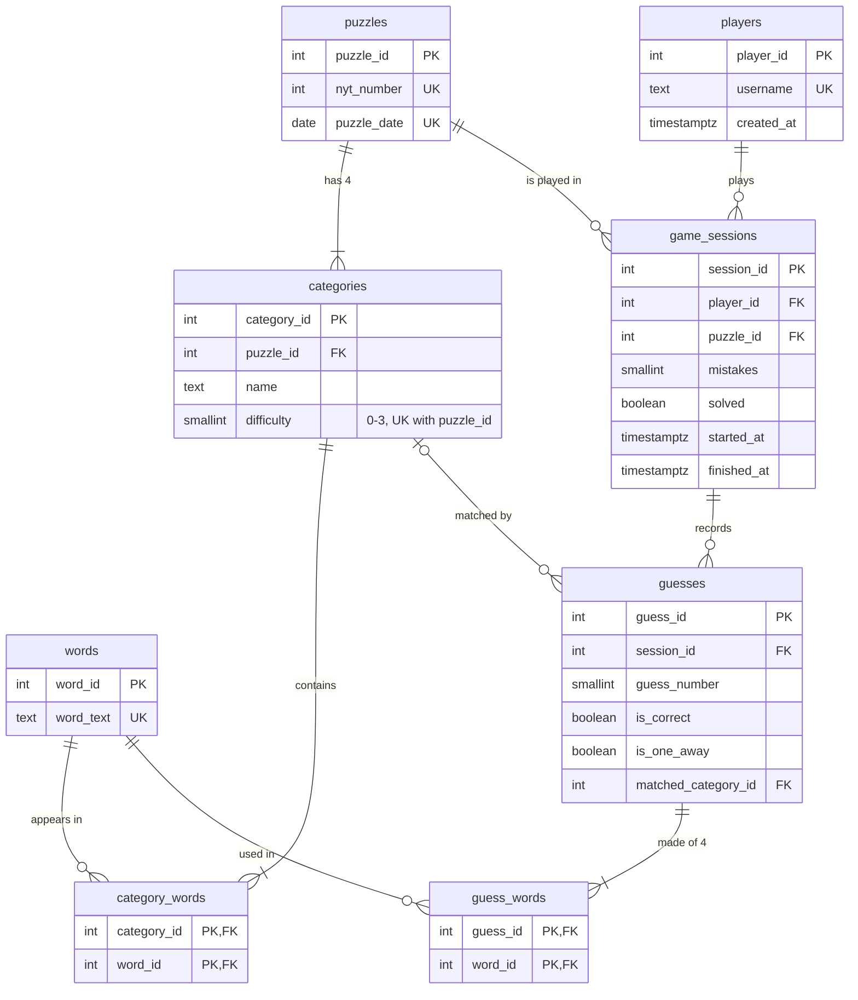

# Link Logic — Database Design Document

Course: Database & Data Warehousing · Project theme: *Building a Database Backend for a Puzzle Solver*
Puzzle chosen: **NYT Connections**

---

## 1. Problem statement

NYT Connections presents 16 words that must be partitioned into 4 hidden groups
of 4, each group tied by a theme (Yellow = easiest … Purple = hardest). The
puzzle is deliberately adversarial: words are chosen so several *plausible*
groupings exist, and only one is right.

Our idea: **the archive of past puzzles is a knowledge base.** Words repeat
across years; words that were grouped together before are probably related;
words that have lived in many different themes are exactly the "trap" words the
puzzle uses to mislead. A relational database over the archive lets a solver
extract these signals with plain SQL — no AI needed.

## 2. ER diagram

## 3. Why relational, and why 3NF

We chose **PostgreSQL (relational)** over a document/key-value store because
the solver's value comes from *relationships across puzzles*: the same word
linked to many categories over the years. In a document store each puzzle
would be a self-contained JSON blob and every cross-puzzle question would be
a full-collection scan with application-side joins. In a normalized schema
those questions are index-backed joins.

Normalization argument (all tables are in 3NF):

- **1NF** — no repeating groups: the 4 words of a category are rows in
  `category_words`, not an array column; the 4 words of a guess are rows in
  `guess_words`.
- **2NF** — the only composite-key tables (`category_words`, `guess_words`)
  carry no non-key attributes at all, so no partial dependencies exist.
- **3NF** — no transitive dependencies: e.g. a category's color depends only
  on `categories.difficulty` (its own attribute), a puzzle's date lives only
  in `puzzles`, and word text lives only in `words`.

The **canonical vocabulary table (`words`)** is the key design decision. Word
text is stored exactly once, ever; every appearance is a `(category_id,
word_id)` pair. Deduplication is what turns "has HEAT ever been grouped with
JAZZ?" into a 3-way index join instead of a string search over every puzzle.

Deliberate denormalization avoided: none needed. The heaviest solver query
(pairwise co-occurrence) runs in single-digit milliseconds at archive scale
(see §5), so we did not precompute a pair table.

## 4. Indexing decisions

| Index | Type | Why |
|---|---|---|
| `idx_category_words_word` on `category_words(word_id)` | B-tree | The PK `(category_id, word_id)` only serves category→words. Every solver query walks word→categories, i.e. the reverse direction. This is the single most important index in the system. |
| `idx_categories_puzzle` on `categories(puzzle_id)` | B-tree | Grid assembly: fetch a puzzle's 4 categories. |
| `idx_categories_name_trgm` on `categories(name)` | GIN (pg_trgm) | Fuzzy "theme hypothesis" search over 4.4K category names. |
| `idx_words_text_trgm` on `words(word_text)` | GIN (pg_trgm) | Fuzzy word lookup from the UI. |
| `idx_sessions_player`, `idx_sessions_puzzle`, `idx_guesses_session` | B-tree | Leaderboard / analytics joins over gameplay tables. |

Indexes we deliberately did **not** create:

- `puzzles(puzzle_date)`, `words(word_text)`, `players(username)` — already
  indexed implicitly by their UNIQUE constraints.
- `categories(difficulty)` — 4 distinct values; too unselective to help.
- `guess_words(word_id)` — rare analytical use, hot insert path.

## 5. Benchmarks

Method: each benchmark drops the index in question **inside a transaction that
is rolled back**, so both plans are measured against identical data
(`db/05_benchmark.sql`). Measured on PostgreSQL 18, local machine, warm cache,
1,111 puzzles / 4,444 categories / 17,776 junction rows (execution time from
`EXPLAIN ANALYZE`).

| # | Query | Without index | With index | Speed-up | Plan change |
|---|---|---|---|---|---|
| B1 | word → categories join | 2.62 ms | 0.47 ms | **5.6×** | Seq Scan on `category_words` + Hash Join → Bitmap Index Scan on `idx_category_words_word` |
| B2 | grid co-occurrence self-join (S2) | 2.50 ms | 0.65 ms | **3.8×** | full-table Hash Join → Nested Loop with 16 index probes |
| B3 | fuzzy theme match (`%`) | 16.79 ms | 1.43 ms* | **11.7×** | Seq Scan computing `similarity()` on all 4,444 names → GIN Bitmap Index Scan touching 138 candidates |
| B4 | date range on `puzzles` | — | 0.03 ms (quarter) / 0.20 ms (full archive) | — | no explicit index needed: the `UNIQUE(puzzle_date)` constraint's implicit B-tree serves both |

\* B3 has a story worth telling: with the GIN index present, the planner
**still chose the sequential scan** (its I/O-centric cost model underestimates
how CPU-expensive `similarity()` is per row — ~16 ms of pure CPU over 4.4K
rows). Forcing the index with `SET enable_seqscan = off` proves the GIN plan
is an order of magnitude faster. Takeaway: on small-but-CPU-heavy predicates,
`EXPLAIN ANALYZE` measurements — not optimizer estimates — are the ground
truth, and the index earns its keep as the table grows.

## 6. How the solver works

Given the 16 words of a live puzzle, the solver runs the signal queries in
`db/04_solver_queries.sql` (also exposed at `/api/solver/*`), always excluding
the puzzle being solved:

| Signal | SQL techniques | What it tells the player |
|---|---|---|
| S1 word history | 3-table inner join | What a word has meant before |
| S2 pair co-occurrence | self-join + aggregation | Word pairs with shared history → group seeds |
| S3 candidate groups | CTE + `HAVING COUNT(*) >= 2` + `ARRAY_AGG` | Past categories overlapping today's grid — the strongest signal |
| S4 trap words | aggregation + `RANK()` window | Which grid words are historically ambiguous |
| S5 theme hypothesis | `pg_trgm` similarity | Whether a guessed theme has precedent |
| S6 archive analytics | date range + `GROUP BY` | Meta-statistics over the archive |
| S7 difficulty extremes | correlated `EXISTS` subqueries | Words that were both Yellow and Purple answers |

Gameplay analytics live in views (`db/03_views.sql`): leaderboard
(`RANK()` over filtered aggregates), per-puzzle difficulty from real play,
and per-color solve order.

## 7. Data source, cleaning & scale

Community-maintained archive of NYT Connections answers (JSON), loaded by
`etl/load_data.py`. The load is idempotent (`ON CONFLICT DO NOTHING` at every
level), so the same script performs the initial load and incremental top-ups.

Data-quality rules discovered while loading the real archive (the schema's
CHECK constraints caught both):

1. **Missing difficulty levels** — from puzzle #832 (2025-09-20) the archive
   stopped recording the official level (all `-1`), 281 puzzles affected. The
   answers array is still ordered Yellow→Purple, so the ETL assigns difficulty
   by array position when the recorded levels are not exactly {0,1,2,3}.
2. **Unrecoverable puzzle** — the 2025-04-01 April Fools puzzle (#660) used
   symbol-only "words" (¥, €, …) that the archive stored as empty strings;
   it is skipped.

| Table | Rows (loaded) |
|---|---|
| puzzles | 1,111 |
| categories | 4,444 |
| words | 8,012 distinct |
| category_words | 17,776 |

17,776 appearances over 8,012 distinct words = **each word appears ~2.2×
on average** — that reuse is precisely the signal the solver mines.
